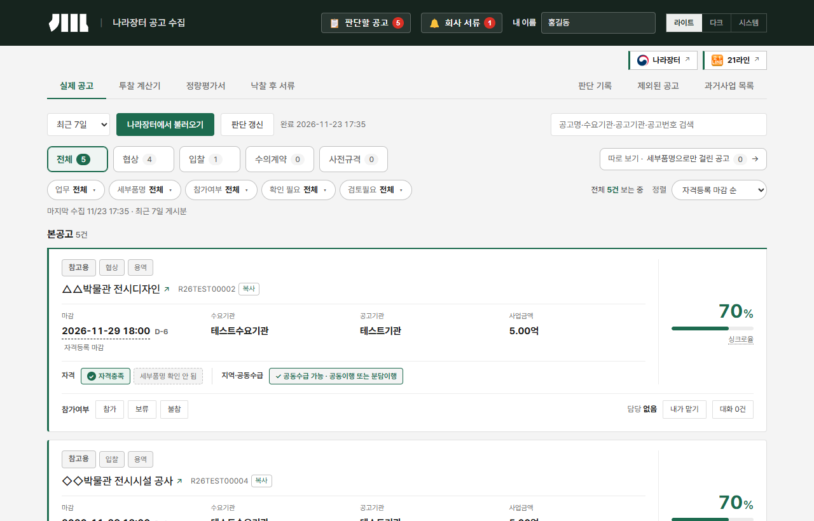
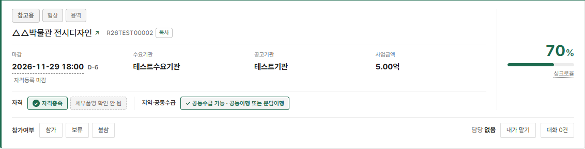
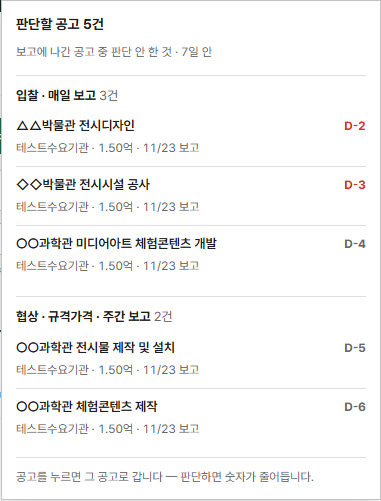
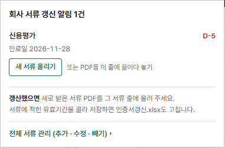
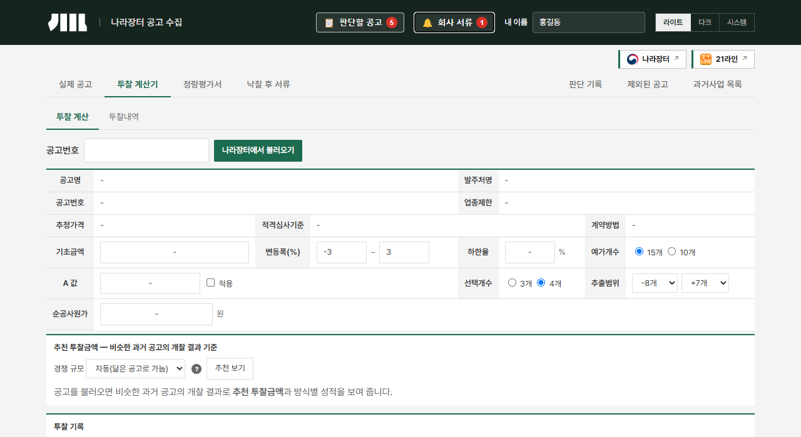

# 지일 입찰 공고 도우미

나라장터 공고를 **매일 자동으로 모아서**, 지일이 할 만한 공고만 골라 보여 줍니다.
팀은 **웹앱 하나**에서 공고를 보고, 참가 여부를 정하고, 회사 서류를 챙깁니다.

> 아래 화면은 모두 **시험용 가짜 자료**입니다.

---

## 하루는 이렇게 흘러갑니다

### 1. 아침 9시 — 텔레그램으로 보고가 옵니다

- 평일 09:00: 어제 올라온 **입찰** 공고
- 월요일 09:10: 지난주 **협상·규격가격** 공고 (메일로도)
- 메시지 끝 **판단하러 가기**를 누르면 웹앱이 열립니다.

### 2. 웹앱에서 공고를 봅니다



- **위쪽 탭**: 전체 · 협상 · 입찰 · 수의계약 · 사전규격
- 공고는 **마감이 급한 순서**로 나옵니다.

공고 카드 하나는 이렇게 읽습니다.



| 어디 | 뜻 |
|---|---|
| 마감 · D-6 | 남은 날짜. 날짜를 누르면 전체 일정 |
| 자격 | 지일 면허로 참가할 수 있는지 (✓ 충족 · ✗ 미달) |
| 지역·공동수급 | 지역 제한, 다른 회사와 같이 들어갈 수 있는지 |
| 70% 싱크로율 | 지일이 예전에 한 사업과 얼마나 비슷한지 |
| 참가 · 보류 · 불참 | **누르면 바로 저장**. 사유를 고르면 다음에 비슷한 공고에 함께 보입니다 |

### 3. 📋 판단할 공고 — 아직 안 정한 것만 모아 봅니다



- 보고에 나간 공고 중 **아직 판단 안 한 것**의 건수
- 입찰(매일)과 협상·규격가격(주간)을 **따로** 보여 줍니다.
- 공고를 누르면 그 카드로 갑니다. **판단하면 숫자가 줄어듭니다.**

### 4. 🔔 회사 서류 — 유효기간을 챙깁니다



- 30일 안에 끝나는 서류가 뜹니다.
- 새로 받은 PDF를 **그 줄에 끌어다 놓고**, 유효기간을 고르면 끝.
  - 옛 파일은 `[이전 서류]`로, 인증서갱신.xlsx 날짜도 같이 바뀝니다.
- **전체 서류 관리**: 새 서류 추가 · 파일 바꾸기 · 날짜 수정 · 빼기

### 5. 투찰할 때 — 투찰 계산기



- 공고번호를 넣고 **나라장터에서 불러오기** → 기초금액·하한율이 채워집니다.
- **추천 투찰금액**과 예비가격 모의 추첨을 보여 줍니다.
- 투찰한 금액을 기록해 두면, 개찰 뒤 결과가 저절로 붙습니다.

---

## 그 밖의 탭

| 탭 | 무엇 |
|---|---|
| 정량평가서 | 공고 서식을 회사 정보로 채워 한 파일로 |
| 낙찰 후 서류 | 낙찰되면 착공·준공 서류 폴더를 만들어 줌 |
| 판단 기록 | 참가·보류·불참으로 정한 공고 모음 |
| 제외된 공고 | 걸러진 공고와 그 이유 (잘못 빠졌으면 다시 올리기) |
| 과거사업 목록 | 지일이 예전에 한 사업 |

---

## 켜기 · 반영하기 (담당자용)

- **NAS 웹앱**: main에 병합하면 10분 안에 저절로 받아서 다시 켜집니다. 브라우저에서 **F5**만.
- **서버 PC 웹앱**: 켜 둔 창에서 `Ctrl+C` → 아래 한 줄 → 브라우저 F5

```bash
cd "C:\Users\HJE\나라장터 수집\Negotiate-Contract-Logic-First-try" && git checkout main && git pull && bash webapp/start.sh
```

- 처음 설치·인증키·텔레그램 봇 설정: [SETUP.md](SETUP.md)

---

## 더 알고 싶으면

| 문서 | 내용 |
|---|---|
| [docs/ARCHITECTURE.md](docs/ARCHITECTURE.md) | 수집 흐름·판정 규칙·설정 (개발자용, 예전 README) |
| [docs/user_guide.md](docs/user_guide.md) | 담당자용 웹앱 사용 안내 |
| [docs/telegram.md](docs/telegram.md) | 텔레그램 보고·명령어 |
| [docs/HANDOFF.md](docs/HANDOFF.md) | 이어받을 때 읽는 요약 |
| [CLAUDE.md](CLAUDE.md) | 날짜별 결정 기록 |
